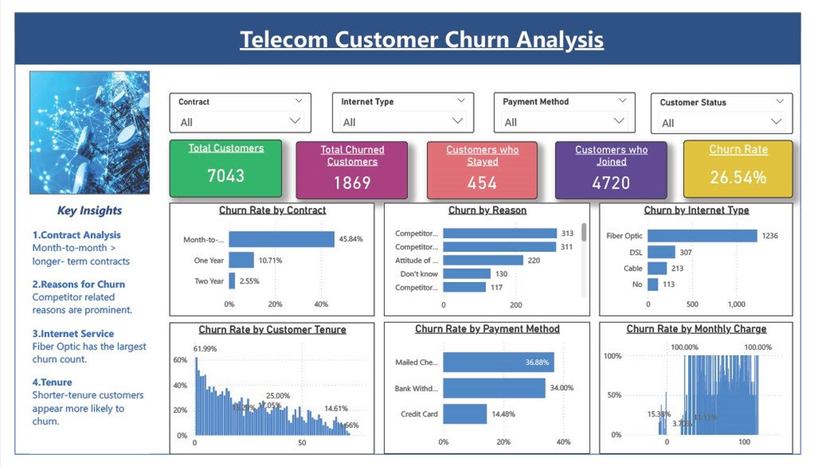

# Telecom Customer Churn Analysis using Power BI

## Project Overview

This project focuses on analysing telecom customer churn data using Microsoft Power BI. The objective is to understand customer behaviour, identify churn patterns, explore reasons behind customer attrition, and gain insights that can help businesses improve customer retention.

## Tools Used

- Microsoft Power BI
- Power Query
- DAX (Data Analysis Expressions)
- Microsoft Excel / CSV Dataset

## Dataset Overview

- Dataset: Telecom Customer Churn
- Total Records: 7,043 customers
- Data includes customer information, services, billing details, usage patterns, and churn-related information.

## Data Cleaning and Transformation

The following data preparation activities were performed:

- Checked data quality and missing values.
- Identified blank values in multiple columns.
- Analysed missing values based on related customer service information.
- Handled blank values appropriately based on business context.
- Prepared the dataset for analysis and visualisation.

## Key Areas of Analysis

- Customer Churn Analysis
- Customer Status Analysis (Churned, Stayed, and Joined)
- Churn Category Analysis
- Customer Service and Internet Service Analysis
- Customer Usage Patterns
- Monthly Charges and Revenue-related Analysis
- Customer Retention Opportunities

## Business Objectives

- Understand customer churn patterns.
- Analyse the distribution of churned and retained customers.
- Identify the major categories associated with customer churn.
- Explore the relationship between customer services and churn.
- Understand customer behaviour through interactive visualisations.
- Provide insights that can support customer retention strategies.

## Skills Demonstrated

- Data Cleaning and Transformation
- Data Analysis
- Power Query
- DAX Measures
- Data Visualisation
- Interactive Dashboard Development
- Business Intelligence
- Dashboard Design

## Project Status

Completed

## Dashboard Preview

